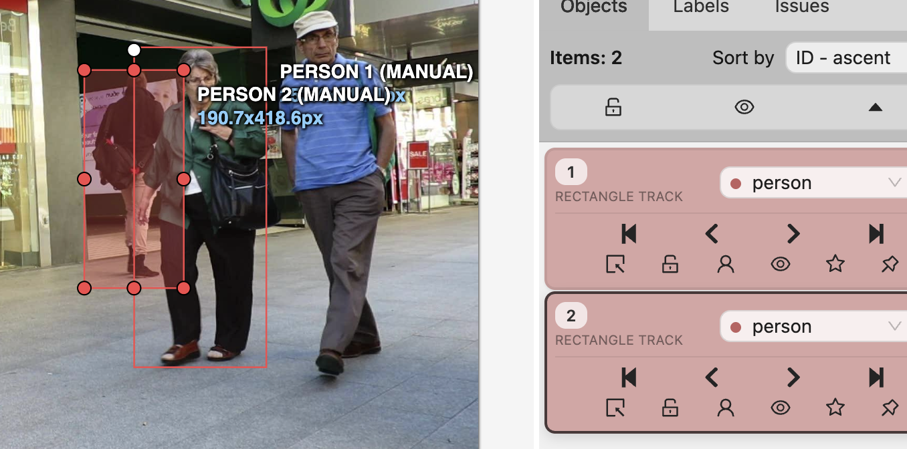
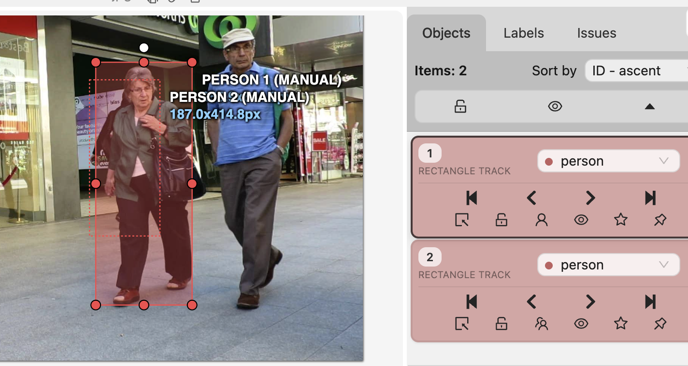
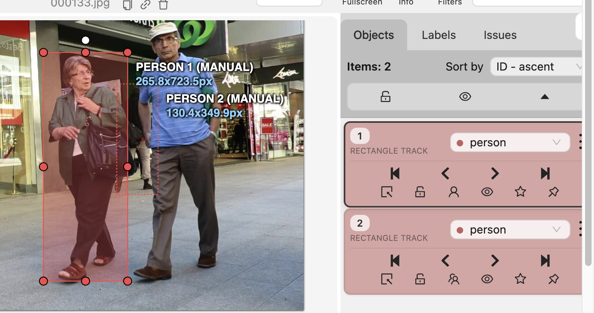

# Báo cáo cá nhân — HoVaTen-MSSV

Đổi tên file theo quy tắc `MSSV_HoTen.md`. Ví dụ: `20241234_NguyenVanAn.md`.

Đoạn video: MOT17-09, 150 frame (frame 1–150), nguồn MOTChallenge, giấy phép CC BY-NC-SA 3.0.

## 0. Thông tin học viên

- Họ tên: Hoàng Thu Hương
- MSSV: 2A202603143
- Mã đề (A/B/C): B
- Email: huonghoang.work18237@gmail.com
- Link repository: https://github.com/borisbrjch/K5-L2-HoangThuHuong-2A202603143-MOTTracking/tree/main
- Giờ bắt đầu: 16:49pm 13/11/2026
- Giờ kết thúc: 19:16pm 13/11/2026

## 1. Xem trước đoạn video (CP0)

Ghi **trước khi vẽ**, mỗi người một dòng.

| Mã | Frame xuất hiện | Frame cuối thấy được | Rẽ / dừng / đổi tốc độ ở frame | Bị che ở frame | Ghi chú |
|---|---|---|---|---|---|
| P1 | 0 | 149 | Không có | Không có | Người phụ nữ mặc áo vest xanh lá cây |
| P2 | 19 | 116 | Đi thẳng, tốc độ đều từ frame 57 | Từ frame 118 tới 149 | Người đàn ông áo đen, quần be |
| P3 | 0 | 149 | Đi thẳng, đều hơn từ frame 85 | 38 | Người áo đen ở trong cửa hàng |
| P4 | 77 | 149 | Không có | Bị che bởi cái bàn, nhưng vẫn nhìn rõ 97% cơ thể, từ frame 77 tới 95 | Người phụ nữ mặc áo ba lỗ trắng, đeo túi xách |
| P5 | 30 | 149 | Không có | Bị che từ frame 0 tới 37 | Người đàn ông mặc áo polo màu blue |

## 2. Keyframe và thời gian (CP1, CP4)

Số keyframe lấy từ kết quả `src/check_submission.py`.

Đối chiếu mã người với track trong hai file xuất (ghép theo khoảng frame có mặt):

| Mã | `track_id` trong `gt/gt.txt` | `track id` trong `annotations.xml` |
|---|---:|---:|
| P1 | 1 | 0 |
| P2 | 3 | 1 |
| P3 | 2 | 2 |
| P4 | 5 | 3 |
| P5 | 4 | 4 |

| Mã | Số keyframe | Keyframe ở frame | Số frame có mặt | Keyframe / 100 frame | Thời gian (phút) | Chỗ khó |
|---|---:|---|---:|---:|---:|---|
| P1 | 18 | 0, 10, 20, 30, 40, 50, 60, 70, 80, 90, 100, 110, 120, 130, 135, 140, 145, 149 | 150 | 12,0 | | Người duy nhất có mặt đủ 150 frame; phải thêm keyframe dày hơn ở cuối (135, 145) khi đổi tốc độ |
| P2 | 14 | 24, 34, 44, 50, 54, 64, 74, 84, 94, 104, 114, 117, 130, 134 | 103 | 13,6 | | Đoạn bị che ở frame 110–129: thêm keyframe 114 và 117 ngay trước khi mất hẳn, 130 ngay khi hiện lại |
| P3 | 17 | 0, 10, 20, 30, 50, 56, 60, 62, 70, 80, 90, 100, 110, 120, 130, 140, 149 | 140 | 12,1 | | Bị che quanh frame 38 và vắng (`outside`) 40–49; keyframe 56, 60, 62 để bám lại sau khi hiện ra |
| P4 | 9 | 72, 82, 92, 102, 112, 122, 132, 142, 149 | 78 | 11,5 | | Đi thẳng đều nên keyframe thưa; chỉ khó ở đoạn bị cái bàn che một phần |
| P5 | 13 | 30, 40, 50, 60, 70, 80, 90, 100, 110, 120, 130, 140, 149 | 120 | 10,8 | | Xuất hiện từ frame 30, đi đều; 40 frame mang cờ `occluded` |
| **Tổng** | **71** | | **591** | **12,0** | **30p** | |

Keyframe / 100 frame của cả bài = tổng keyframe ÷ tổng số frame có mặt × 100 = 71 ÷ 591 × 100 = **12,0**.

Bạn đặt keyframe nhiều nhất ở người nào? Vì sao (người đó rẽ, dừng, lại gần camera hay bị che)?

 P1 nhiều nhất (18 keyframe) vì đây là người duy nhất có mặt đủ 150 frame. Nhưng tính theo mật độ thì P2 mới là người dày nhất (13,6 keyframe / 100 frame): P2 đi qua đoạn bị che từ frame 110 đến 129, nên tôi phải đặt thêm keyframe ngay trước lúc mất hẳn (114, 117) và ngay khi hiện lại (130) — đúng luật "keyframe ngay trước khi bị che và ngay sau khi hiện lại". Ngược lại P5 thưa nhất (10,8) vì người này đi thẳng đều, nội suy tuyến tính đã đủ chính xác.

## 3. Đoạn bị che (CP2)

Người bị che: `P2`

| Mốc | Frame |
|---|---:|
| Bắt đầu bị che một phần (bật `occluded`) | 110 |
| Mất hẳn (bật `outside`) | 120 |
| Hiện lại (tắt `outside`) | 130 |
| Thấy rõ trở lại (tắt `occluded`) | Không có |

- Thời gian khuất hẳn: ___ frame = ___ giây.
- Quyết định: giữ cùng ID / tạo track mới.
- Lý do (trả lời 3 câu: khuất bao lâu so với 60 frame, ngoại hình có khớp, chỗ hiện lại có đúng hướng và tốc độ):

Khuất 10 frame = 0.33 giây. Vẫn là một người áo đen, quần be, đeo túi, dáng cao, đi cùng hướng và cùng tốc độ nên tôi quyết định giữ ID, đồng thời bật tắt các cờ outside / occlude tương ứng mức độ nhận diện của vật thể thay vì tạo track mới.

Ảnh chụp màn hình:





## 4. Tự review ID (CP3)

Lượt 1 theo người (đi ngược từ frame 149 về 0 trên CVAT), lượt 2 theo cảnh (nhảy 10 frame). Ít nhất 3 dòng; không có lỗi thì ghi một dòng "đã kiểm hai lượt, không lỗi".

Loại lỗi dùng đúng một trong 7 mã: `id_switch`, `fragmentation`, `lost`, `merge`, `false_track`, `drift`, `flag`.

| Frame | Mã người | Loại lỗi | Mô tả một câu | Phát hiện ở lượt | Đã sửa? |
|---:|---|---|---|---|---|
| | | | | | |
| | | | | | |
| | | | | | |

Tổng hợp số lỗi theo loại:

| `id_switch` | `fragmentation` | `lost` | `merge` | `false_track` | `drift` | `flag` |
|---:|---:|---:|---:|---:|---:|---:|
| | | | | | | |

Lỗi nào chỉ lượt 2 (theo cảnh) mới thấy, lượt 1 (theo người) không thấy? Vì sao?

Đã kiểm 2 lượt, không có lỗi.

## 5. File xuất và kết quả tự kiểm (CP4)

| Kiểm tra | Kết quả |
|---|---|
| Tên file MOT 1.1 |'HoangThuHuong_mot.zip' |
| Tên file CVAT for video 1.1 | 'HoangThuHuong_cvat_video.zip' |
| Số track ID khác nhau trong `gt/gt.txt` (phải là 5) | 5 |
| Frame `outside` không có dòng trong `gt.txt` (đúng / sai) | sai |
| Job đã completed trên CVAT máy cá nhân | đúng |

Dán phần tóm tắt in ra từ `src/check_submission.py`:

```text
Số frame in theo CVAT (bắt đầu từ 0). Trong gt.txt, frame_id = frame CVAT + 1.

=== File MOT 1.1: HoangThuHuong_mot.zip ===
  Số track ID: 5   |   Tổng số box: 591
  [OK]        Đúng 5 track ID.

  Track | Frame có mặt | Số frame | Đoạn vắng (outside)
      1 |   0–149      |      150 | -
      2 |   0–149      |      140 | 40–49
      3 |  24–136      |      103 | 120–129
      4 |  30–149      |      120 | -
      5 |  72–149      |       78 | -


=== File CVAT for video 1.1: HoangThuHuong_cvat_video.zip ===

  Track | Nhãn   | Frame thấy | Keyframe | KF/100 frame | Frame occluded | Lần bật outside
      0 | person |        150 |       18 |         12.0 |              0 |               0
              Track 0: keyframe ở frame [0, 10, 20, 30, 40, 50, 60, 70, 80, 90, 100, 110, 120, 130, 135, 140, 145, 149]
      1 | person |        103 |       14 |         13.6 |             10 |               2
              Track 1: keyframe ở frame [24, 34, 44, 50, 54, 64, 74, 84, 94, 104, 114, 117, 130, 134]
      2 | person |        140 |       17 |         12.1 |             66 |               1
              Track 2: keyframe ở frame [0, 10, 20, 30, 50, 56, 60, 62, 70, 80, 90, 100, 110, 120, 130, 140, 149]
      3 | person |         78 |        9 |         11.5 |             30 |               0
              Track 3: keyframe ở frame [72, 82, 92, 102, 112, 122, 132, 142, 149]
      4 | person |        120 |       13 |         10.8 |             40 |               0
              Track 4: keyframe ở frame [30, 40, 50, 60, 70, 80, 90, 100, 110, 120, 130, 140, 149]

  Tổng: 71 keyframe / 591 frame có mặt = 12.0 keyframe / 100 frame
  [OK]        Đọc được 5 track từ annotations.xml.

=== Tóm tắt ===
  Lỗi: 0   |   Cảnh báo: 0
  Đạt. Dán phần tóm tắt này vào báo cáo mục 5.
```

## 6. Ba câu kết

1. Nếu được gán lại, bạn sẽ đặt keyframe khác ở đâu? Vì sao?

   Bắt đầu gắn keyframe của P3, và P4 sớm hơn vài frame. Vì ở thời điểm đó tôi đã có thể nhận biết được object.

2. Có chỗ nào bạn không chắc "cùng ID hay ID mới"? Bạn đã quyết định và ghi chú thế nào?

   Không có trong bài lab của tôi. Tuy nhiên tôi nghĩ cùng ID cần phải có căn cứ, ví dụ như cùng hình dáng, màu sắc, hướng đi tuyến tính,...

3. Một lỗi ID trong job của bạn (nếu không còn sót, chọn lỗi đã sửa) có thể làm xe tự lái dự đoán sai chuyển động của người đó như thế nào? Lỗi đó ảnh hưởng MOTA hay IDF1 nhiều hơn?

   Trong job của tôi đã soát 2 lần, không có lỗi. Nhưng tôi có thể lấy một ví dụ lỗi về ID có thể gây ảnh hưởng đến dự đoán của xe tự lái. Đó là lỗi box drift. Nếu lỗi này còn sót, tracker sẽ ước lượng vận tốc của người từ hai vị trí không liên quan — ví dụ box nhảy khoảng cách giữa (người A) và (người B) chỉ trong 1/30 s, tương đương vận tốc vài trăm km/h — khiến xe tự lái dự đoán người đó ở sai vị trí trong tương lai và phản ứng (phanh/né) sai. Lỗi này ảnh hưởng IDF1 nhiều hơn MOTA, vì MOTA chỉ trừ 1 điểm cho mỗi lần đổi ID trong khi IDF1 bị phạt trên toàn bộ phần track còn lại mang sai danh tính. 

## Bonus (nếu làm)

### B1 — Hai người đi sát

...

### B2 — So cách đặt keyframe

| Cách đặt | Số keyframe | Frame trôi nhất | Ghi chú |
|---|---:|---:|---|
| Đều mỗi 30 frame | | | |
| Theo chỗ đổi hướng | | | |

...

### B3 — So với tracker có sẵn

| Frame | Mã người | Tracker làm gì | Nhãn của bạn | Giải thích (đoán rồi sửa / ghép IoU / box score thấp / ngoại hình) |
|---:|---|---|---|---|
| | | | | |
| | | | | |

## 7. Tài liệu tham khảo và công cụ AI đã dùng

gpt, claude